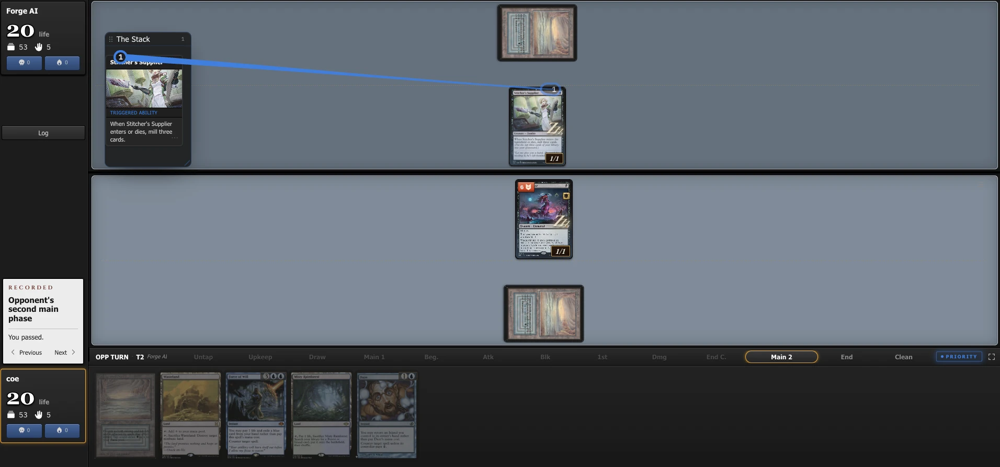

# Endstep MTGO Skin

Chrome extension that makes [endstep.cc](https://endstep.cc) games look and lay out like **Magic: The Gathering Online**.

Extensión de Chrome que hace que las partidas de endstep.cc se vean y se distribuyan como **MTGO**.

Made by [@imcoesus](https://x.com/imcoesus).

---

## Qué hace

- **Estilo MTGO:** gris carbón, campo de batalla gris pizarra, vidas grandes en blanco, botones con relieve.
- **Layout MTGO:** columna izquierda con jugadores y prompt, campo del rival arriba y el tuyo abajo, barra de fases horizontal encima de la mano.
- **Log fijo a la derecha**, de arriba a abajo. Se abre solo al empezar cada partida.
- **Columna de zonas, como en MTGO:** cementerio, exilio y cartas reveladas de cada jugador, apilados a la izquierda de su campo de batalla (el rival arriba, tú abajo). Se abren solos en cuanto tienen cartas.
- **Barra superior:** match y games, de quién es el turno, prioridad y cartas reveladas.
- **Stops claros:** marcador azul encima de la fase para el turno del rival y dorado debajo para el tuyo.

El layout solo cambia en pantallas de 768 px o más. En móvil se mantiene el diseño de Endstep con los colores de MTGO.

## Instalación

1. Descarga el `.zip` de la última versión en [Releases](../../releases) y descomprímelo. Guarda la carpeta en un sitio fijo, porque Chrome la usa desde ahí.
2. Abre `chrome://extensions`.
3. Activa **Modo de desarrollador** (arriba a la derecha).
4. Pulsa **Cargar descomprimida** y elige la carpeta `endstep-mtgo-skin` (la que tiene `manifest.json`).
5. Abre o recarga una partida en endstep.cc.

También funciona en Brave, Edge, Arc, Opera y otros navegadores basados en Chromium.

## Uso

- Se activa sola en endstep.cc.
- Para encenderla o apagarla, pulsa el icono de la extensión y marca o desmarca **Enabled**.
- **Log:** si lo cierras con la ✕ se queda cerrado. Se vuelve a abrir con el botón **Log** de abajo a la izquierda.
- **Zonas:** se abren solas cuando tienen cartas. La calavera (cementerio) y la llama (exilio) de cada jugador las muestran u ocultan en la columna.
- **Stops:** pulsa la mitad de arriba de una fase para el turno del rival y la de abajo para el tuyo.
- **Redimensionar:** arrastra el borde izquierdo del log o el borde derecho de la columna de zonas. El contenido (cartas y texto) se agranda o encoge con el ancho, y el tamaño se recuerda. Doble clic en el borde para volver al tamaño por defecto.

## Privacidad y seguridad

Esta extensión **no recoge, guarda ni envía ningún dato**.

| | |
|---|---|
| Webs en las que funciona | Solo `https://endstep.cc/*` |
| Conexiones a internet | Ninguna: no hay analíticas, rastreo ni servidores |
| Permisos | Solo `storage`, para recordar si está encendida o apagada |
| Qué hace en la página | Cambia el CSS y pulsa botones de la propia Endstep: abrir el log, el cementerio y el exilio, y su "Pop out" |

Todo el código está en este repositorio y es corto:

- [`manifest.json`](manifest.json): permisos y en qué web corre
- [`mtgo.css`](mtgo.css): el aspecto y el layout
- [`content.js`](content.js): el interruptor, el log fijo, la barra superior y la columna de zonas
- [`popup.html`](popup.html) / [`popup.js`](popup.js): la ventanita del icono

Puedes comprobar que no hay ninguna petición de red buscando `fetch`, `XMLHttpRequest` o `http` en el código: las únicas URLs son `endstep.cc` (dónde se ejecuta) y `x.com/imcoesus` (el enlace del autor).

## English

**Install:** download the zip from [Releases](../../releases), unzip it, open `chrome://extensions`, turn on *Developer mode*, click *Load unpacked*, pick the `endstep-mtgo-skin` folder and reload your game.

**Privacy:** collects and sends no data. It only runs on endstep.cc, makes no network requests, and its only permission (`storage`) remembers the on/off switch.

## Aviso / Disclaimer

Proyecto de un fan, sin relación con Endstep, Wizards of the Coast ni Daybreak Games. Fan project, not affiliated with Endstep, Wizards of the Coast or Daybreak Games. Magic: The Gathering and MTGO are trademarks of their respective owners.

## Licencia

[MIT](LICENSE)
